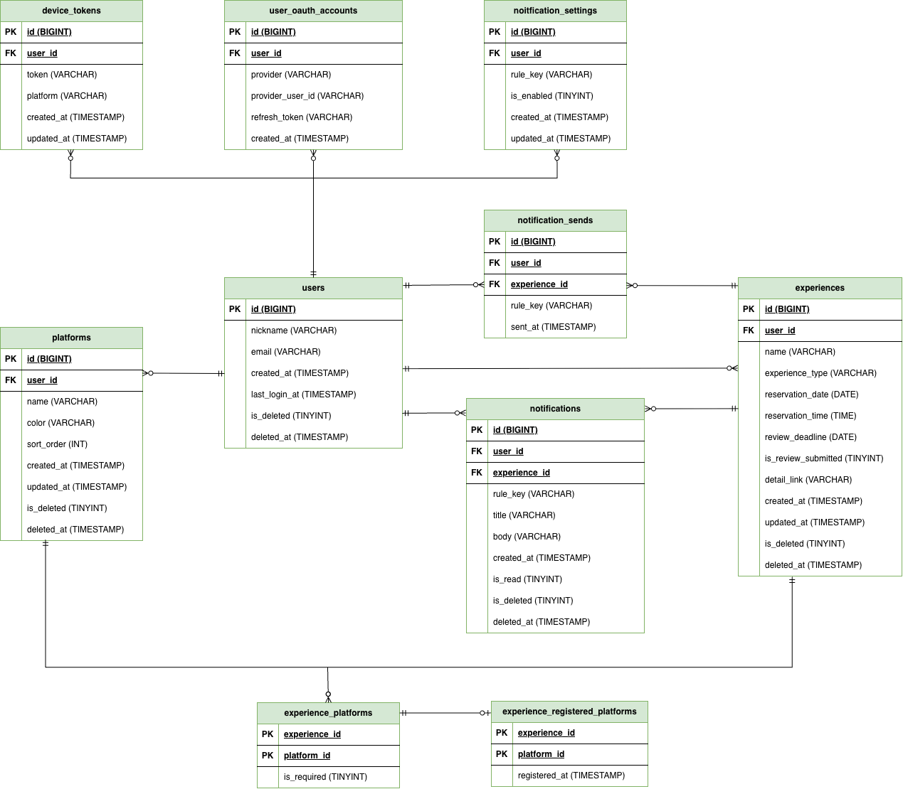

# 🗂️ PROJECT OUTLINE
### ✔️ 프로젝트명
- 나만의 체험단
### ✔️ 개발 배경
- 블로그, 인스타그램 등 다양한 플랫폼에 리뷰를 올리는 인플루언서들을 위한 **통합 리뷰 일정 관리 어플**입니다.
- 리뷰를 모집하는 플랫폼은 다양하게 나눠져 있어 그 일정을 모두 소화하고 관리하기 위해서는 인플루언서가 한 곳에서 별도로 관리해야 합니다.
- 이를 보다 효율적으로 관리할 수 있도록 지원하는 것이 **나만의 체험단** 앱입니다.
- 어떤 사이트에서 지원받았는지, 어느 플랫폼에 리뷰를 업로드해야 하는지, 마감일과 체험일은 언제인지 등을 보다 효율적으로 관리하고 통합하여 한 눈에 확인하고자 개발하였습니다.
### ✔️ 역할
- **개인 프로젝트**로, 기획 + 다자인 + 프론트&백엔드 개발 + 배포 모두 혼자 진행하였습니다.
 

# ⚙️ SYSTEM STRUCTURE
### 시스템 아키텍처
### ERD

 

# 💡 TECH STACK & WHY?
### ✔️ 사용 기술

| 구분 | 기술 |
|---|---|
| Backend |        |
| Frontend |      |
 

### ✔️ 왜 앱 푸시를 위해 **FCM**을 사용했는가?
  > **❓첫 방향성은 MQTT!**
  - 이전 회사에서 Saas 개발 시 화면에 알림을 띄우기 위해 MQTT를 사용했던 기억이 있어, 앱 푸시 기능을 개발하기 전 MQTT로 서버에서 전부 구현하여 관리하는 방향을 고려했습니다.
  - MQTT는 Publish/Subscribe 구조로 유연한 확장이 가능하며, QoS를 통한 신뢰성 있는 메세지 전달 그리고 경량 헤더로 네트워크 대역폭과 CPU를 적게 소모한다는 장점이 있었습니다.
  - 그러나 나만의 체험단은 스마트폰에서 사용할 앱 서비스이므로 어플이 꺼져있을 때에도 소켓이 유지되어야 하는데, MQTT가 메세지 전달을 보장하는 구간은 앱 프로세스가 살아있으며 브로커와 소켓이 연결된 동안입니다. 안드로이드는 Doze와 배터리 최적화 때문에 백그라운드 연결을 곧 죽이고, 아이폰은 일반 앱이 백그라운드에서 소켓을 유지하는 것 자체를 허용하지 않습니다.

  > **💡 FCM을 선택한 이유와 효과**
  - FCM 사용 시 앱 구동 여부에 관계 없이 알림을 전달할 수 있어 사용자 입장에서 일정 알림에 대한 신뢰도가 높아집니다.
  - 발송 API 호출만 연동하므로, 개발 속도가 빨라집니다

  > **🆚 MQTT와 FCM의 비교**  
  
  || MQTT | FCM |
  |---|---|---|
  | 맞는 상황 | 앱이 켜져 있고 소켓이 연결된 동안 | 앱이 꺼져 있어도 전달 |
  | 안드로이드 | 배터리 최적화가 백그라운드 연결을 끊음 | OS 푸시 채널로 전달 |
  | 아이폰 | 일반 앱의 백그라운드 소켓이 불가 | APNs로 전달 |
  | 서버 작업 | 브로커 운영 | 발송 API 호출 |
 

### ✔️ 헥사고날 아키텍처를 선택한 이유는?
  > 🐙 **요청의 in/out 경로가 많은 나만의 체험단**
  - 평소 익숙하게 사용한 방식은 컨틀롤러 /서비스 / 레포지토리로 나뉜 계층형 서비스였습니다.
  - 나만의 체험단 서비스의 경우 기획 단계에서 고려한 요청의 in/out이 발생하는 경로가 모두 2개 이상이었습니다.
    - in: `HTTP`, `Schedular`
    - out: `MySQL`, `Google•Naver•Kakao`, `FCM`
  - 요청의 in/out이 수정되어도 가운데 로직은 변경되지 않도록 입구와 출구만 갈아 끼우는 구조가 필요했습니다.
  
  > **🆚 계층형 구조와 헥사고날 아키텍처** 
  
  || 계층형 | 헥사고날 |
  |---|---|---|
  | 읽는 법 | 한 기능이 서비스 클래스 하나에 모임 | 동작 하나가 유즈케이스 파일 하나 |
  | 장점 | 파일이 적고, 익숙한 사람이 바로 찾음 | 입구와 바깥 시스템을 바꿔도 가운데 규칙이 남음 |
  | 단점 | 서비스가 커지면 DB, 외부 API, 규칙이 한 클래스에 섞임 | 인터페이스와 변환 클래스가 늘어 처음 읽는 비용이 큼 |
  | 잘 맞는 경우 | 입구가 HTTP뿐이고 저장소가 DB 하나일 때 | 입구가 여러 개이고 바깥 시스템도 여러 개일 때 |
  | 테스트 | 서비스가 JPA에 붙어 있으면 DB와 같이 검증하는 경우가 많음 | 규칙은 DB 없이, 외부 호출은 가짜 인터페이스로 검증 가능 |
 

# 📋 API
### 인증

| Method | 주소 | 설명 |
|---|---|---|
| POST | `/api/auth/google` | 구글 로그인 후 JWT를 발급한다. |
| POST | `/api/auth/kakao` | 카카오 로그인 후 JWT를 발급한다. |
| POST | `/api/auth/naver` | 네이버 로그인 후 JWT를 발급한다. |

### 내 정보

| Method | 주소 | 설명 |
|---|---|---|
| GET | `/api/me` | 로그인 사용자의 프로필을 조회한다. |
| PATCH | `/api/me` | 닉네임을 변경한다. |
| DELETE | `/api/me` | 회원 탈퇴를 처리한다. |

### 알림

| Method | 주소 | 설명 |
|---|---|---|
| GET | `/api/me/notifications` | 내 알림을 최신순으로 조회한다. |
| PATCH | `/api/me/notifications/{id}/read` | 알림 하나를 읽음 처리한다. |
| PATCH | `/api/me/notifications/read-all` | 읽지 않은 알림을 모두 읽음 처리한다. |
| DELETE | `/api/me/notifications` | 알림을 soft delete한다. 본문 `idList`로 여러 건을 지울 수 있다. |

### 알림 설정

| Method | 주소 | 설명 |
|---|---|---|
| GET | `/api/me/notification-settings` | D3, TODAY, OVERDUE 수신 여부를 조회한다. |
| PATCH | `/api/me/notification-settings` | 규칙별 푸시 수신 여부를 변경한다. |

### 디바이스 토큰

| Method | 주소 | 설명 |
|---|---|---|
| PUT | `/api/me/device-tokens` | 디바이스 토큰을 등록하거나 같은 토큰이면 갱신한다. |
| DELETE | `/api/me/device-tokens` | 본인 디바이스 토큰을 삭제한다. |

### 체험

| Method | 주소 | 설명 |
|---|---|---|
| GET | `/api/experiences/upcoming` | 아직 제출하지 않은 체험 목록을 조회한다. |
| GET | `/api/experiences/completed` | 제출이 끝난 체험 목록을 조회한다. |
| GET | `/api/experiences/{id}` | 체험 상세를 조회한다. |
| POST | `/api/experiences` | 체험을 만들고 리뷰 플랫폼을 연결한다. |
| PATCH | `/api/experiences/{id}` | 체험 내용과 플랫폼 구성을 수정한다. |
| DELETE | `/api/experiences` | 체험 1건 이상을 동시에 soft delete한다. |
| PUT | `/api/experiences/{id}/platforms/{platformId}/registration` | 해당 플랫폼의 리뷰 등록 완료 여부를 바꾼다. |
| PATCH | `/api/experiences/{id}/submission` | 체험 전체의 리뷰 제출 여부를 바꾼다. |

### 플랫폼

| Method | 주소 | 설명 |
|---|---|---|
| GET | `/api/platforms` | 삭제되지 않은 내 플랫폼 목록을 조회한다. |
| POST | `/api/platforms` | 플랫폼을 추가한다. |
| PATCH | `/api/platforms/{id}` | 플랫폼 이름·색을 수정한다. |
| DELETE | `/api/platforms/{id}` | 플랫폼을 soft delete한다. |
| PUT | `/api/platforms/reorder` | 플랫폼 표시 순서를 바꾼다. |

### 기타

| Method | 주소 | 설명 |
|---|---|---|
| GET | `/api/health` | 서버가 살아 있는지 확인한다. |
| GET | `/legal/privacy`, `/privacy` | 개인정보 처리방침 페이지를 연다. |
| GET | `/legal/terms`, `/terms` | 이용약관 페이지를 연다. |
 

# 👩🏻‍💻 RETROSPECT
#### ✔️ 성과
- 협찬 서비스들을 한 곳에서 통합 관리할 수 있습니다.
- 사용자가 마감 직전, 마감 초과, 체험 예약일 미정 등을 한 눈에 확인할 수 있도록 색으로 표시합니다.
- 마감일과 체험일을 놓치지 않도록 주요 일정 정보를 스케줄러를 통해 확인하고, 사용자에게 앱 푸시로 알립니다.
